# 🛠️ The AuraDesk Build Journal — from empty folder to live URL

> **What this file is:** the development log of this project — every decision, every bug,
> and every redesign, in chronological order, with screenshots.
>
> **Live result:** https://auradesk-six.vercel.app

---

## 📍 Chapter 0 — Why this project exists

**The goal:** build a series of 3 agentic-AI projects of increasing depth:

1. 🥉 **AuraDesk** (this project) — a single AI support agent that proves the fundamentals:
   RAG, tool calling, guardrails, human-in-the-loop, observability.
2. 🥈 **Agent Evaluation Dashboard** — measures how good agents actually are
   (the 👍/👎 feedback buttons in AuraDesk were added specifically to feed this project).
3. 🥇 **AI Agent Command Center** — the capstone: multiple agents orchestrated together.

**Why a support agent first?** Because it's the one agentic use case everyone
instantly understands, and it naturally requires every core skill: the agent must *know
things* (RAG), *do things* (tools), *refuse things* (guardrails), and *give up gracefully*
(human escalation).

**The stack decision:** React + Vite, **pure front-end, no backend**.
- *Why no backend?* The demo must work the moment anyone opens the link —
  no API keys, no servers to keep alive, no cold starts, zero hosting cost.
- *How can an "AI" work without a backend?* The agent pipeline (retrieval, intent
  classification, tool execution, guardrails) is 100% real deterministic code running in
  the browser. Only the final *reply-wording* step is swappable: a template composer in
  demo mode, or a real LLM (Groq / Llama 3.1) if a `VITE_GROQ_API_KEY` is present.
  This is the **LLM abstraction** pattern — one file (`src/agent/llm.js`) knows which
  "brain" is plugged in; nothing else cares.

**In one sentence:** the agent's decision-making is separated from the language
generation, so the system demos deterministically without a key and upgrades to a live
LLM by adding one env var — no other file changes.

---

## 🏗️ Chapter 1 — The architecture (what got built first)

The first working version had the entire agent brain in `src/agent/`:

| File | Role | The concept it demonstrates |
|---|---|---|
| `agent.js` | The loop: PERCEIVE → THINK → ACT → RESPOND | Agent loop / orchestration |
| `knowledgeBase.js` | 6 policy articles | The "knowledge" half of RAG |
| `retriever.js` | Tokenize → score → top-k | The "retrieval" half of RAG |
| `tools.js` | 4 tools + mock orders DB | Tool / function calling |
| `guardrails.js` | PII block, scope block, refund limit | Safety & human-in-the-loop |
| `llm.js` | Demo composer ⟷ live Groq | LLM abstraction |

Key early decisions and the reasoning behind them:

- **Keyword retrieval instead of embeddings.** Deliberate. The pipeline *shape*
  (query → rank → top-k → ground the answer) is identical to a production vector-DB
  setup; keyword scoring just makes the ranking explainable in 10 lines. In production,
  `retrieve()` would swap to cosine similarity over embeddings — same interface,
  different scorer.
- **Guardrails are deterministic rules, not AI.** On purpose — a rule can't be
  sweet-talked by prompt injection. The LLM is *downstream* of the safety checks.
- **Every step `emit()`s a trace event.** The UI's Agent Trace panel is just a consumer
  of these events. That's observability (what LangSmith/Langfuse sell) built in from day one.
- **ORD-1003 costs ₹54,999 on purpose.** It exceeds the ₹5,000 auto-refund limit, so asking
  for a refund on it triggers the guardrail → ticket → human escalation chain. A one-click demonstration of
  the full escalation chain.

---

## 💥 Chapter 2 — The first real bug: the blank screen

Right after the big UI rebrand, the app died. The dev server ran fine, the build passed,
but the page was just… dark. Nothing.

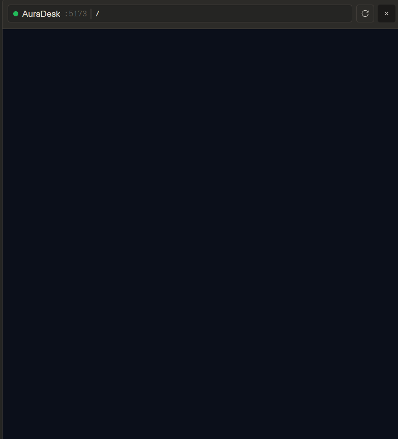
*The preview after the rebrand: server up on :5173, page completely empty. No visible error.*

**The diagnosis journey (this is the valuable part):**
1. `vite build` → **passed**. So it wasn't a syntax error.
2. Server-side render test → **passed**. So the components were valid.
3. Only a **real headless browser** (Playwright + Chromium) surfaced the crash:
   `TypeError: destroy is not a function` from React.

**Root cause** — one pair of missing braces:

```js
// ❌ CRASHES: the arrow function implicitly RETURNS scrollToBottom's return value.
// React treats anything returned from useEffect as a "cleanup function"
// and tries to call it on unmount → boom.
useEffect(() => scrollToBottom(), [messages])

// ✅ SAFE: braces make the function body return undefined.
useEffect(() => { scrollToBottom() }, [messages])
```

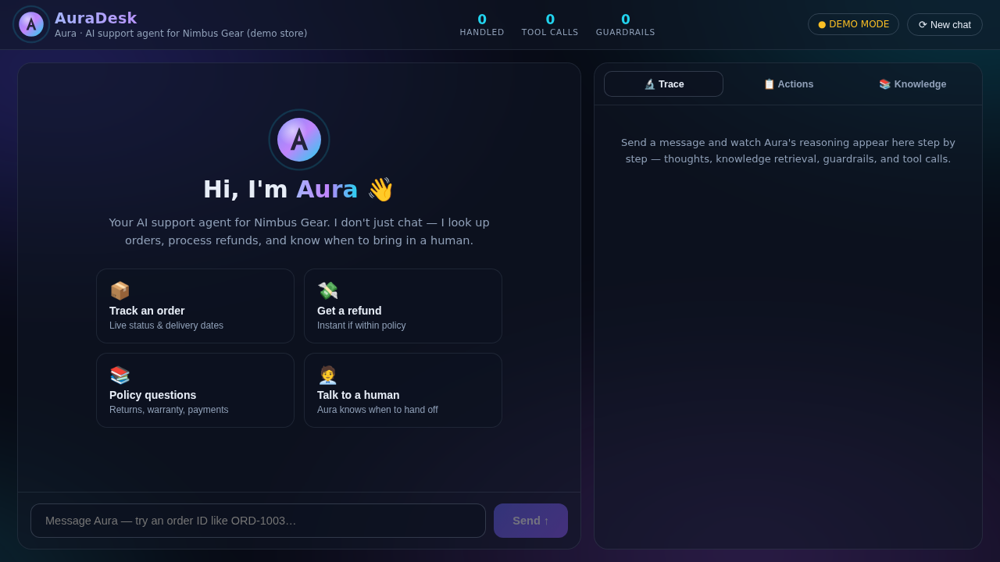
*The same app, one `{ }` later.*

**Lessons:**
- `useEffect`'s return value has a *meaning* (cleanup). Implicit arrow returns are a trap.
- **A passing build ≠ a working app.** Builds check syntax; only runtime checks behavior.
  This is why the project got a Playwright smoke test that runs the app in a real browser
  and fails on any page error — and that test caught every regression afterwards.

---

## 🎨 Chapter 3 — Iterating on the UI (driven by real feedback)

The first version worked but looked like a developer tool. A series of feedback-driven
iterations turned it into a product. Each one below was a user complaint → a fix.

### 3.1 "Hide the raw JSON, those tabs look ugly"

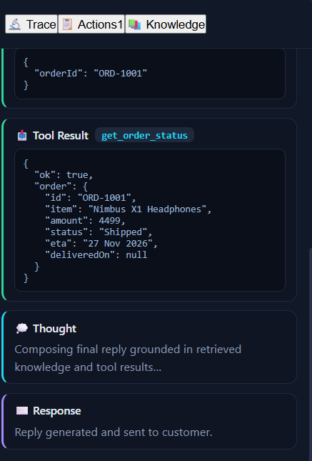
*Before: every tool call dumped its full JSON payload into the trace, and the tabs were unstyled boxes.*

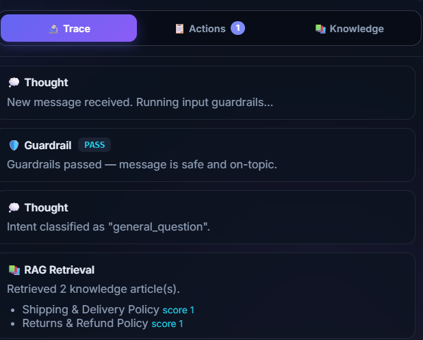
*After: a modern segmented control for Trace / Actions / Knowledge, human-readable one-line summaries per event.*

Changes:
- Raw JSON payloads moved behind a **collapsed `<details>` toggle** ("view JSON payload").
  Scannable by default, inspectable on demand — the same pattern real observability tools use.
- Tool results got **`summarizeResult()`**: a function that turns
  `{"ok":true,"order":{...}}` into `ORD-1001 · Nimbus X1 Headphones · Shipped · ETA 27 Nov 2026`.
- Tabs restyled as a pill-shaped segmented control with an active gradient.

**Lesson:** raw data is for machines; UIs summarize first and reveal detail on request.

### 3.2 The rebrand + settings

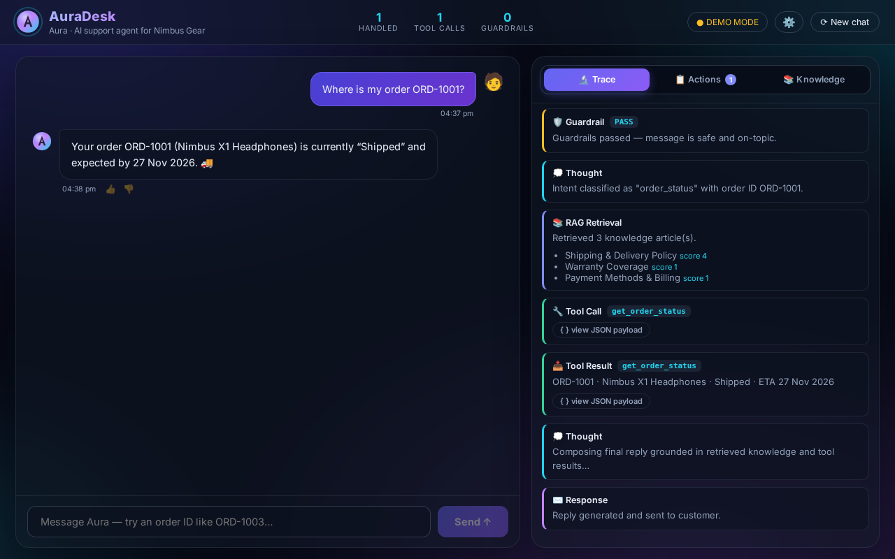
*AuraDesk: aurora background (animated CSS gradients), glassmorphism panels, hero cards with one-click demo prompts.*

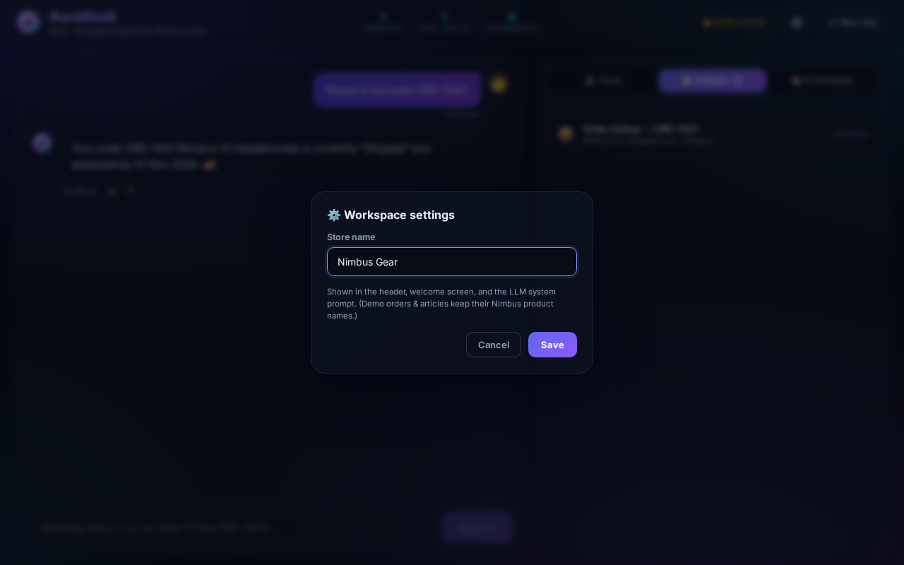
*⚙️ Settings: the store Aura works for is configurable and persisted in localStorage.*

- Brand: **AuraDesk**, agent persona **Aura**, logo drawn as inline SVG (no image assets).
- `settings.js` became the single owner of localStorage — swap it for a real API later
  and no other file changes (same isolation idea as `llm.js`).

### 3.3 "The site breaks when I resize the window"

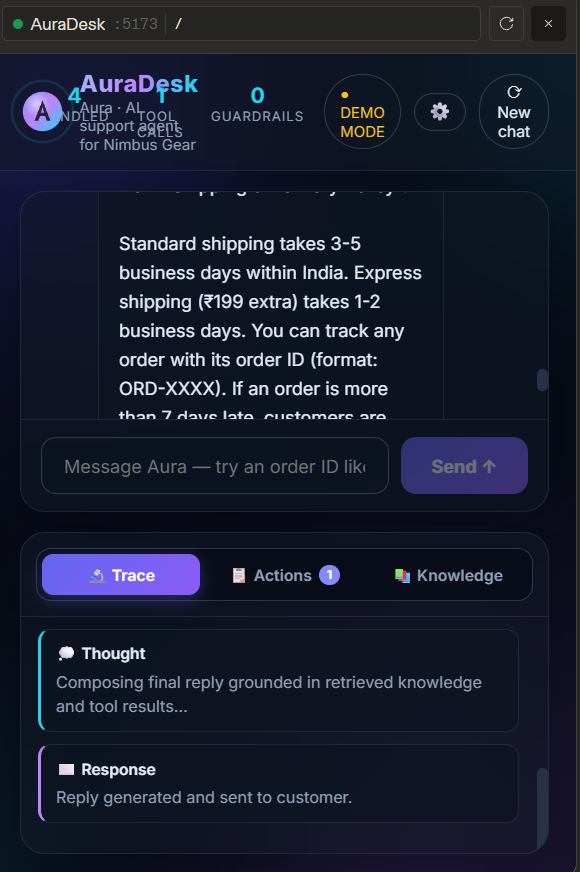
*User screenshot: at narrow widths the topbar overlapped itself and the two-column grid crushed both panels.*

Fix — a real responsive strategy instead of hoping:
- **>1150px:** everything.
- **≤1150px:** the stat counters (nice-to-have) disappear first.
- **≤900px:** the 2-column grid becomes a vertical stack; the *page* scrolls
  (desktop locks scrolling to the inner panels; stacked layouts must not).
- **≤560px:** tighter paddings, single-column hero cards, trimmed labels.

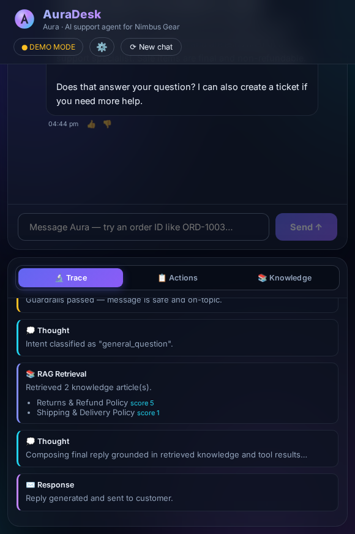
*~580px: stacked panels, sticky topbar.*

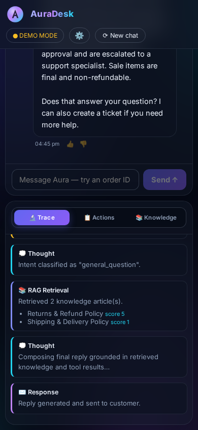
*390px (iPhone): still fully usable.*

**Lesson:** degrade *content* by priority (hide stats first, never the chat), and know that
locked-viewport layouts must become page-scrolling layouts when stacked.

### 3.4 "What can I even ask it?" — capability discovery

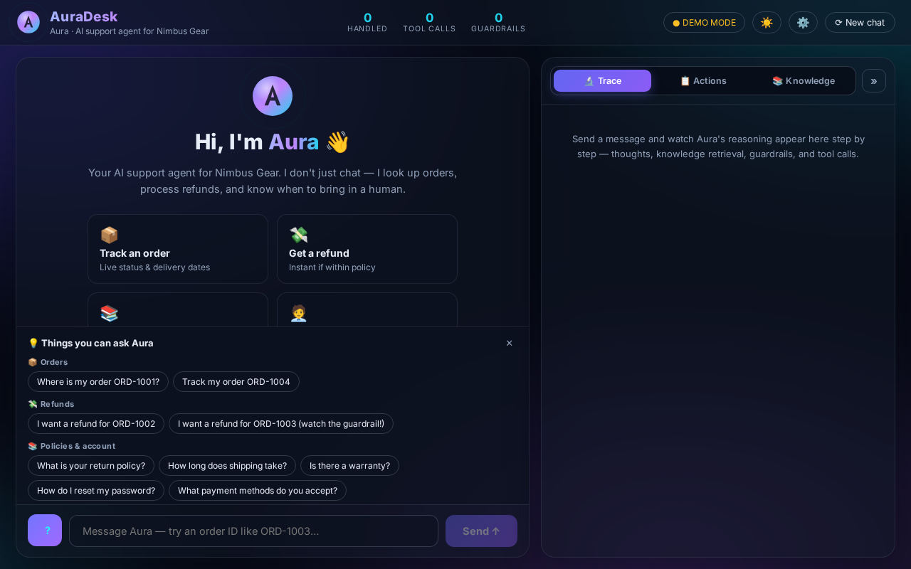
*The "?" button opens a grouped menu of everything Aura can do — every item is one click to send.*

Two changes with one philosophy:
- A **help box** above the composer listing every capability, grouped (Orders, Refunds,
  Policies, Products, Human help).
- The off-script fallback reply was rewritten: instead of a dead-end *"Sorry, I don't
  know"*, Aura lists exactly what she *can* do.

**Lesson:** an agent's scope limits are a *feature* (guardrails), but failures must be
**helpful** — redirect the user to what works instead of apologizing.

### 3.5 Dark/light theme + collapsible trace panel

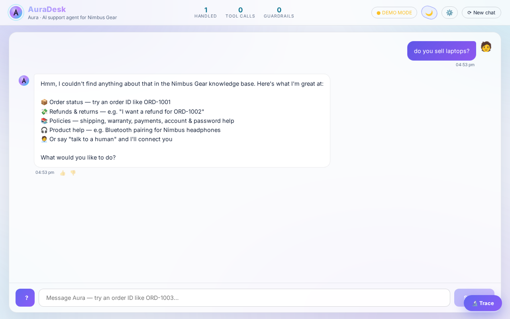
*Light mode. The whole theme is CSS variables, so light mode is one variable swap triggered by `data-theme="light"` on `<html>`.*

---

## 🐛 Chapter 4 — Two subtle UX bugs (and the patterns that fixed them)

### 4.1 The page that scrolled itself

**Bug report:** while Aura was typing her answer, the page kept yanking itself down —
fighting the user who was trying to scroll up and read.

**Root cause:** `element.scrollIntoView()`. It scrolls **every scrollable ancestor**,
including the page itself. During the typewriter animation it fired constantly.

**Fix — the "stick-to-bottom" pattern** (what every real chat app uses):

```js
// Only follow new content if the user is ALREADY at the bottom (within 80px).
// The moment they scroll up to read, we stop touching their position entirely.
stickToBottom.current = el.scrollHeight - el.scrollTop - el.clientHeight < 80

// And we only ever move the chat container itself — never scrollIntoView:
if (stickToBottom.current) el.scrollTop = el.scrollHeight
```

**Lesson:** autoscroll must be *conditional on user intent*, and `scrollIntoView` is the
wrong tool inside any scrollable panel.

### 4.2 The collapse button that "broke" the app

**Bug report:** "when I collapse the trace panel I can't get it back — the restore button
is on top of the Send button."

**Root cause:** the restore control was a **floating action button** (position: fixed),
and at certain window sizes it landed exactly on the composer's Send button.

**Fix:** abandoned the floating button entirely. The collapsed panel now becomes a slim
**56px rail** that stays in the grid layout — it can't overlap anything because it
*occupies real layout space*. Below 900px it rotates into a horizontal bar.

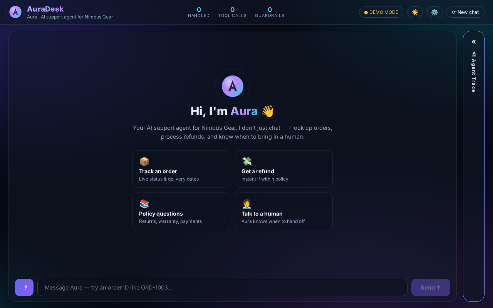
*Collapsed state: the rail is always visible, always clickable, overlaps nothing.*

**Lesson:** floating/fixed elements are overlap bugs waiting to happen. If a control must
always be reachable, give it real space in the layout.

---

## ✍️ Chapter 5 — The last feature round: composer + rename reach

Two final requests before shipping:

**1. "Make the chat box bigger."**
- The chat:trace column ratio went from 1.45:1 → **1.65:1**.
- The single-line `<input>` became an **auto-growing `<textarea>`**:
  Enter sends, Shift+Enter makes a newline, grows to ~4 lines then scrolls.
  The auto-grow trick: set `height:auto` then `height = scrollHeight` on every keystroke.

**2. "When I rename the store, the KB answers still say the old name."**
- The warranty article said "All **Nimbus Gear** products…" — hardcoded.
- Fix: articles now contain a **`{{store}}` placeholder**, and `getKnowledgeBase()`
  interpolates the *current* store name **at read time**, fresh on every retrieval.

```js
// Template interpolation, resolved at READ time — like {{first_name}} in email tools.
content: article.content.replaceAll('{{store}}', getSettings().storeName)
```

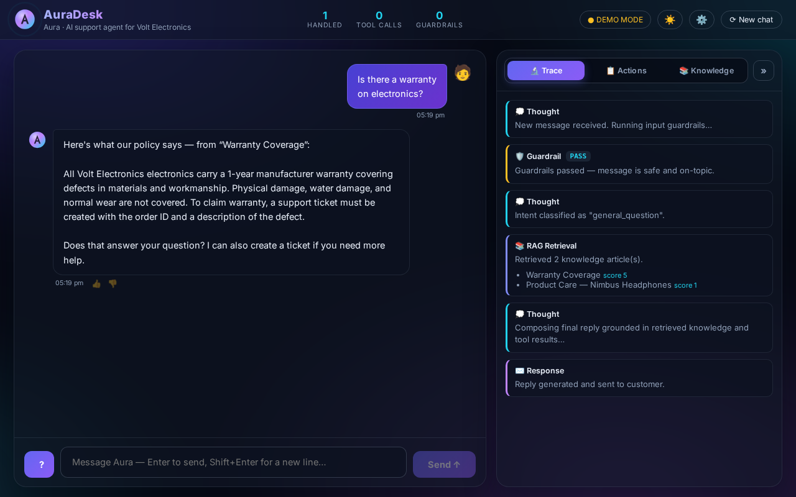
*Verification run: store renamed to "Volt Electronics" in settings → the very next warranty
answer says "All Volt Electronics products…". Also visible: the multi-line composer.*

**Design decision:** old chat messages do **not** retroactively change
(a chat is an immutable record), and product names like "Nimbus X1" stay fixed
(renaming a store doesn't rename its product catalog). Knowing *where the rename should
stop* is the interesting part.

---

## 🚀 Chapter 6 — Shipping: Vercel via raw API (a war story)

Pre-ship decisions: skip favicon/transcript-export/accessibility-pass for v1.1,
and keep the live LLM key out of the public deployment — a browser-side key is visible
to anyone who opens DevTools, so live mode on a public site needs a tiny backend proxy
(a planned v1.1).

The deploy itself was done through Vercel's REST API (no git integration connected), and
it fought back:

1. **`files[0].data should be string`** — the API kept rejecting the upload. After
   isolating variables, the culprit: `package.json`. Its *content is itself JSON*, and a
   layer in the pipeline was parsing the string into an object before Vercel saw it.
   **Fix:** send that file base64-encoded with `"encoding": "base64"`. A perfect example of
   the classic *"data that looks like the protocol"* bug (cousin of SQL injection and
   CSV-formula injection).
2. **Deployments are atomic.** Two deployments went out with only part of the file set —
   each new deployment **replaces** everything; you can't "add" files to one. The fix was
   simply one complete 16-file deployment. Failed attempts were deleted to keep the
   dashboard clean.
3. The complete deployment: **READY in 12 seconds**, promoted to production, verified
   serving HTTP 200.

Also notable: the deployed `package.json` drops the `playwright` devDependency —
its install step downloads entire browsers, which would bloat a cloud build that
never runs tests.

**Result:** https://auradesk-six.vercel.app → GitHub repo `RhugvedWaydande/AuraDesk`,
with the live URL in the repo's About section — which was, fittingly, the very first
question that started this whole project.

---

## 📚 Chapter 7 — Design Q&A

**How does it work end-to-end?**
> Browser-only React app. User message → guardrails (deterministic, pre-LLM) → intent
> classification → RAG retrieval over a knowledge base → tool execution with a
> human-in-the-loop policy gate → grounded reply generation behind an LLM abstraction.
> Every step emits a trace event that powers a live observability panel.

**Why isn't the retrieval semantic?**
> Same pipeline shape as production (query → rank → top-k → ground), explainable scorer.
> Swapping in embeddings + cosine similarity changes one function, not the architecture.

**How is prompt injection handled?**
> Guardrails run *before and outside* the LLM and are plain code — they can't be persuaded.
> The refund limit is enforced in the tool layer too, so even a jailbroken reply can't
> move money; it can only *say* things.

**What was the hardest bug?**
> The `useEffect` blank screen (Chapter 2): an invisible crash behind a passing build,
> diagnosed with a headless browser, fixed with one pair of braces — and it produced the
> regression test that protected every later change.

**What's next?**
> v1.1: a backend proxy so live-LLM mode is safe on the public site. Then an evaluation
> dashboard consuming the 👍/👎 feedback this app already collects — because an agent you
> can't measure is an agent you can't improve.

### Patterns used in this project

| Pattern | Where |
|---|---|
| Agent loop (perceive→think→act→respond) | `agent.js` |
| RAG grounding | `retriever.js` + `llm.js` prompt |
| Tool/function calling | `tools.js` |
| Deterministic guardrails + human-in-the-loop | `guardrails.js` |
| LLM abstraction / graceful degradation | `llm.js` |
| Observability via event emission | `emit()` → trace panel |
| Read-time template interpolation | `getKnowledgeBase()` |
| Stick-to-bottom scrolling | `ChatPanel.jsx` / `RightPanel.jsx` |
| CSS-variable theming | `styles.css` + `data-theme` |
| Priority-based responsive degradation | media queries in `styles.css` |
| useEffect cleanup semantics | Chapter 2 |

---

*Companion docs: [README.md](README.md) (what it is, how to run) and
[CODE_TOUR.md](CODE_TOUR.md) (file-by-file code walkthrough).*
